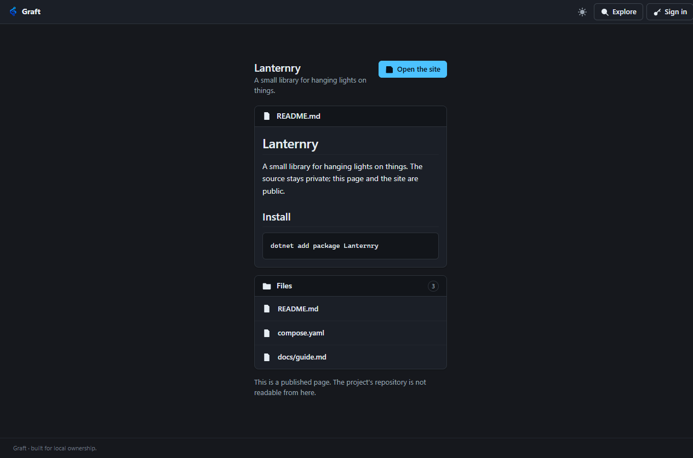
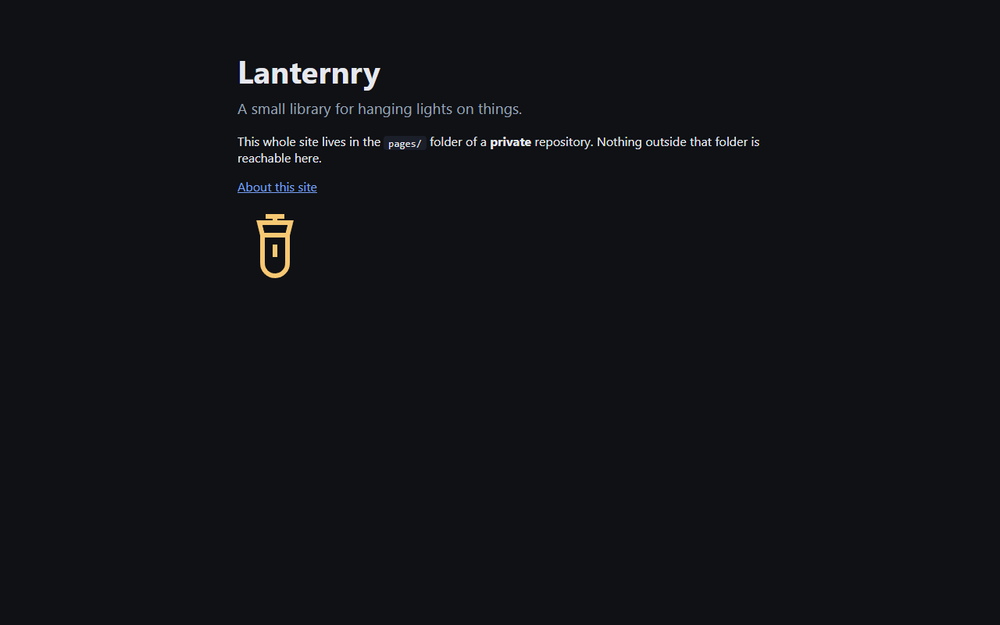

# Project pages

A project page is a curated surface over a repository: a way to share chosen files, a readme, and a static
site, without making the repository readable. The repository can stay private while the page is public.

A page has two halves, and a project may use either or both.

- **The page itself**, on the forge, listing the files the project chose to offer and rendering a readme.
- **A static site**, a folder in the repository served as a website, from a hostname of its own.



## The shape of it

Two things have to be true before anything is served, and they are separate on purpose.

1. **The owner publishes the page.** This is a Maintainer act, done in the browser under the project's
   **Settings** tab. It lives in the database, not in the repository.
2. **The repository says what the page offers**, in `.graft/project.json` on the default branch.

The split matters. Authoring repository content needs only Developer access, while publishing needs
Maintainer. If the config could publish, a Developer could expose a private project by pushing a commit. So
the config can only ever **narrow** what an already-published page offers. A push can never widen access.

## The config

```json
{
  "version": 1,
  "page": {
    "title": "Lanternry",
    "description": "A small library for hanging lights on things.",
    "readme": "README.md",
    "files": ["README.md", "docs/**/*.md", "compose.yaml"],
    "site": { "root": "pages", "index": "index.html" }
  }
}
```

Every field is optional, and so is the file. What is absent is absent.

| Field | What it does |
| --- | --- |
| `title`, `description` | What the page is called and how it is described. Falls back to the project's own. |
| `readme` | One file to render on the page. It must also be matched by `files`. |
| `files` | The patterns that decide which files the page offers. |
| `site.root` | The folder served as a website. |
| `site.index` | The file that answers for a directory. Defaults to `index.html`. |

### Patterns

`*` matches within one path segment. `**` matches across segments, and also matches no directories at all,
so `docs/**/*.md` covers both `docs/guide.md` and `docs/deep/guide.md`.

Nothing else is a metacharacter, and there is no "everything except" form. Patterns are compared whole, so
`docs` does not admit `docs-private/secret.md`.

### Rules the parser enforces

- **Deny by default.** No `files` means no files. An empty list means no files.
- **Unknown fields and unknown feature names are errors**, not warnings, so a config that claims to expose
  something Graft does not have fails loudly instead of appearing to work. The names that exist are listed
  under [Features](#features).
- **An invalid config unpublishes the page.** A parse failure is never a page with default settings.
- **`.graft/` is never servable**, at any visibility, and a config cannot name it.
- **`readme` and `image` must themselves match `files`.** A path named in one field but absent from the
  allowlist is an error, not an implicit grant.

## What a page can never do

A page is a separate read path, not a filter over the repository view. It will not clone, will not serve
history, and will not show a diff, whatever the config says.

That is a deliberate limit rather than an unfinished one. A Git pack is reachability-shaped rather than
path-shaped, so no filter makes `git fetch` honour a file allowlist, and a diff prints the contents of
files the page never named. Every surface that walks the object graph refuses a page grant outright,
because filtering a graph walk is exactly where a leak would hide.

**A restrictive page over a public repository protects nothing.** If the repository is public, its files
are already readable and the page only changes presentation. The settings tab says so where it matters.

## The static site



A site is repository-authored HTML, which cannot share an origin with the forge. Same-origin script would
reach the session cookie's privileges, the CSRF token and every authenticated route, which is precisely
what Graft's readme rendering is built to prevent.

So a site is served **only from a separate pages origin**, a second hostname, and the feature is off until
an operator configures one:

```powershell
dotnet Graft.Server.dll --database <path> --repositories <dir> `
  --public-browsing true --pages-origin https://pages.example.com
```

The session cookie is `__Host-` prefixed and therefore cannot travel to that host. On the pages origin
there is no API, no session, no upload route and no browser shell: a request for `/api/session` or
`/healthz` there answers 404, because none of it exists on that host.

Within it:

- Only files under `site.root` are reachable. Everything else in the repository is not there.
- Content types come from a fixed list of extensions, never from the file's bytes. An extension that is not
  on the list is not served at all.
- Responses carry `X-Content-Type-Options: nosniff`, `Referrer-Policy: no-referrer` and
  `frame-ancestors 'none'`.

The root of the pages origin belongs to no project, so it redirects to the forge. Someone who trims a site's
URL back to the host lands somewhere useful rather than on an explanation of the URL shape. An unknown
project is still a 404, so the redirect never hides a typo.

The root of the pages origin belongs to no project, so it redirects to the forge. Somebody who trims a
site's URL back to the host lands somewhere useful rather than on an explanation of a URL shape they cannot
act on. An unknown project is still a 404, so the redirect never hides a typo.

The address is the project's instance-wide slug, so a shared site URL names no account:

```
https://pages.example.com/<project-slug>/
```

## Linking back to the forge

A site that writes the forge's hostname into a link is wrong the day that hostname changes, and a site is
content somebody wrote once. So Graft answers two paths under the project itself, and resolves them at
request time to wherever the forge is now.

| Path | What it does |
| --- | --- |
| `/<slug>/-/repo` | Redirects to the project's page on the forge. |
| `/<slug>/-/graft.json` | Returns the forge's origin and the project's URLs, for a site that would rather render its own link. |

From a page at the site's root, that is an ordinary relative link with no host in it:

```html
<a href="-/repo">This project on Graft</a>
```

From a page in a subdirectory, use the absolute form, `/<slug>/-/repo`. It names the project's slug, which
is stable, and still names no host.

The JSON is same-origin, so a page can simply fetch it:

```json
{
  "slug": "lanternry",
  "name": "Lanternry",
  "forge": "https://graft.example.com",
  "project": "https://graft.example.com/projects/lanternry",
  "page": "https://graft.example.com/-/p/lanternry"
}
```

Both are resolved before any file is looked up, so a repository cannot shadow them with a file of the same
name. `-` is already Graft's namespace for its own routes.

The redirect goes to the **page** rather than to the repository view, because a site exists only where a
page is published, and a page-only project would refuse the repository view to whoever followed the link.
The page links onward to the source for anyone allowed to see it.

## Trying it

A complete worked example lives in [samples/project-page](../samples/project-page/SAMPLE.md): a config, a
readme, two allowlisted files, a four-file site, and instructions for pushing it.

## Features

`features` names the product surfaces a page points its readers at, by GitLab's names: `issues`,
`merge_requests`, `boards`, `milestones`, `wiki`, `releases` and `snippets`. Naming anything else is an error
and unpublishes the page, as any other invalid config does. The names are links, not grants: naming `issues`
does not make a private project's issues readable. The page offers the links only to a reader the project
itself would admit to those surfaces, so a page-only private project's visitors see none of them and a
public project's visitors see each one as a link to `/projects/<slug>/-/<feature>`, at the shareable address
that names no account. Each name appears once however many times the config repeats it.

The rule was the opposite until 2026-10-30, when every name was an error because there was nothing to name.
Issues arrived with [ADR 0014](decisions/0014-collaboration.md), the rest with ADRs 0020 to 0023, and the
field now means what ADR 0006 said it would.

## What is not built

- **A fallback for operators with one hostname.** A sandboxed frame was considered and is a worse product,
  since links and navigation inside the site break. Without a second hostname there is no site.

See [ADR 0006](decisions/0006-project-pages-and-public-browsing.md) for the reasoning behind all of this.
