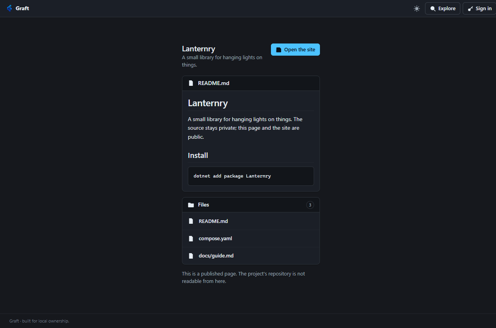
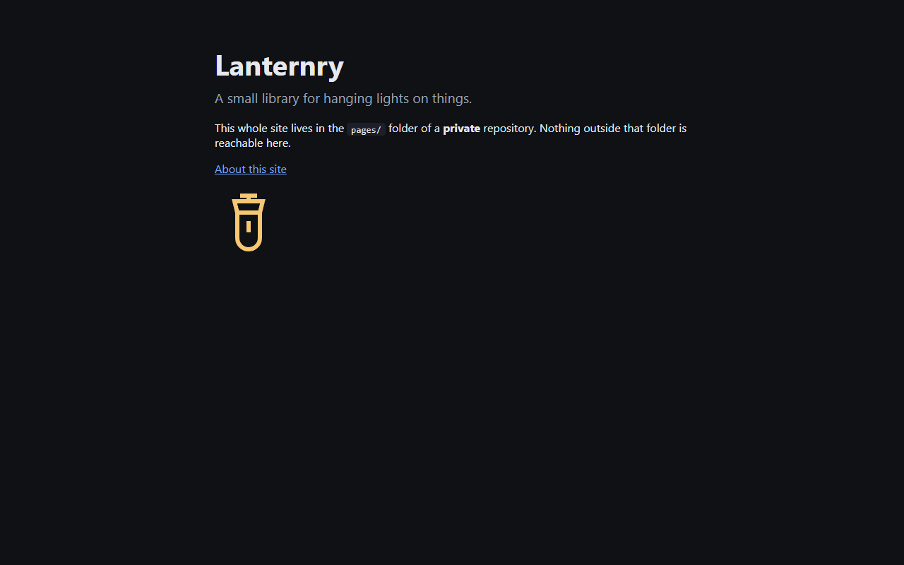

# Project pages

A project page is a curated surface over a repository: a way to share chosen files, a readme, and a static
site, without making the repository readable. The repository can stay private while the page is public.

A page has two halves, and a project may use either or both.

- **The page itself**, on the forge, listing the files the project chose to offer and rendering a readme.
- **A static site**, a folder in the repository served as a website, from a hostname of its own.



## The shape of it

Two things have to be true before anything is served, and they are separate on purpose.

1. **The owner publishes the page.** This is a Maintainer act, done in the browser under the project's
   **Settings** tab. It lives in the database, not in the repository.
2. **The repository says what the page offers**, in `.graft/project.json` on the default branch.

The split matters. Authoring repository content needs only Developer access, while publishing needs
Maintainer. If the config could publish, a Developer could expose a private project by pushing a commit. So
the config can only ever **narrow** what an already-published page offers. A push can never widen access.

## The config

```json
{
  "version": 1,
  "page": {
    "title": "Lanternry",
    "description": "A small library for hanging lights on things.",
    "readme": "README.md",
    "files": ["README.md", "docs/**/*.md", "compose.yaml"],
    "site": { "root": "pages", "index": "index.html" }
  }
}
```

Every field is optional, and so is the file. What is absent is absent.

| Field | What it does |
| --- | --- |
| `title`, `description` | What the page is called and how it is described. Falls back to the project's own. |
| `readme` | One file to render on the page. It must also be matched by `files`. |
| `files` | The patterns that decide which files the page offers. |
| `site.root` | The folder served as a website. |
| `site.index` | The file that answers for a directory. Defaults to `index.html`. |
| `site.artifact` | A [page artifact](#page-artifacts-a-site-that-is-not-committed) that is the site's front door. A site needs `root`, `artifact` or both. |

### Patterns

`*` matches within one path segment. `**` matches across segments, and also matches no directories at all,
so `docs/**/*.md` covers both `docs/guide.md` and `docs/deep/guide.md`.

Nothing else is a metacharacter, and there is no "everything except" form. Patterns are compared whole, so
`docs` does not admit `docs-private/secret.md`.

### Rules the parser enforces

- **Deny by default.** No `files` means no files. An empty list means no files.
- **Unknown fields and unknown feature names are errors**, not warnings, so a config that claims to expose
  something Graft does not have fails loudly instead of appearing to work. The names that exist are listed
  under [Features](#features).
- **An invalid config unpublishes the page.** A parse failure is never a page with default settings.
- **`.graft/` is never servable**, at any visibility, and a config cannot name it.
- **`readme` and `image` must themselves match `files`.** A path named in one field but absent from the
  allowlist is an error, not an implicit grant.

## Beyond files: a semi-public project

A closed-source project can still have public documentation, public bug reports and visible progress. Four
more fields in `page` open those, and each is off until the config names it:

```json
{
  "version": 1,
  "page": {
    "files": ["README.md", "docs/**/*.md"],
    "tree": true,
    "history": { "commits": 100, "authors": "names" },
    "issues": true,
    "releases": true
  }
}
```

| Field | What it shows |
| --- | --- |
| `tree` | The directory structure of the default branch: every path and whether it is a file or a directory. Names only. A file can be opened only if `files` admits it, and the listing says which. |
| `history` | The default branch's recent commits: message and date. `commits` is how many, 1 to 500, 100 if omitted. `authors` is `none` (the default), `names`, or `emails`. Never a diff, a changed-file list or a branch. |
| `issues` | The project's issues, read only: title, description, state, labels, milestone and comments. A confidential issue is not there. Nobody comments or opens one through a page. |
| `releases` | The project's releases: notes, links and attached files, downloadable. No source archive, because an archive is the repository. |

Each is a JSON boolean (or, for `history`, an object) and nothing else: `"true"`, `1` and `"yes"` are
errors that unpublish the page, like any other misspelling here.

So the levels of "semi-public" read, in config:

- **Specific files**: `"files": ["README.md", "compose.yaml"]`
- **Every Markdown file**: `"files": ["**/*.md"]`
- **Specific folders**: `"files": ["docs/**"]`
- **Structure without content**: `"tree": true`
- **Commit messages, no names**: `"history": {}`; with names, `{ "authors": "names" }`; with addresses, `"emails"`
- **Releases and binaries**: `"releases": true`
- **Issues, read only**: `"issues": true`

The issues and releases are served at the page's own routes, `/api/graft/pages/<slug>/issues` and
`/api/graft/pages/<slug>/releases`, and rendered on the page. The project's own API at `/api/v4` still
answers a stranger with a 404 for a page-only project, so a GitLab client does not see them; a reader who
wants them reads the page. See [ADR 0045](decisions/0045-semi-public-projects.md) for why.

## What the page looks like

Since 2026-11-09 ([ADR 0048](decisions/0048-page-looks-like-the-repository.md)) the page wears the
repository's own layout: the project's banner and avatar, the title and description, a tab bar, the file table
with folders and breadcrumbs, and the readme beneath it. Opening a file shows it the way the repository's code
tab does.

- The file table holds what `files` admits, by folder. With `tree: true` it holds the whole structure, and a
  file the allowlist does not admit is shown by name, greyed, and cannot be opened.
- The tabs are Code, then Commits, Issues and Releases when the config opened them, then any `features` links.
- There is no branch selector, clone menu, archive or commit link, because a page has none of those.

**If the config names a `site` and the operator has a pages origin, the site is the page.** `/-/p/<slug>`
forwards to it. Add any `?tab=` (`code`, `commits`, `issues`, `releases`) to stay on the forge's page, which is
how a site links to its own files, issues or releases.

## Pictures in the readme

A readme's pictures are served by the page itself, at `/api/graft/pages/<slug>/image?path=<path>`, to anybody
the page is published to. **A picture must be matched by `files`**, like anything else the page serves:

```json
"files": ["README.md", "docs/**/*.md", "docs/**/*.png"]
```

- Paths resolve the way a forge reads them: relative to the readme's folder, with `./` and `..` understood.
- PNG, GIF, JPEG and WebP are served, as the type the bytes prove. SVG is not, here or anywhere on the forge,
  because an SVG is a document that can run script. Video and audio are not supported.
- A picture `files` does not admit, or one that points off-site or out of the repository, is shown as a link
  instead of an image, so the readme still says what it referenced.
- An image opened from the file table is shown in place, with a download button.

## What a page can never do

A page is a separate read path, not a filter over the repository view. It will not clone, will not show a
diff or a changed-file list, and will not list branches, whatever the config says. Its history, when the
config opens one, is what was said and when, not what changed.

That is a deliberate limit rather than an unfinished one. A Git pack is reachability-shaped rather than
path-shaped, so no filter makes `git fetch` honour a file allowlist, and a diff prints the contents of
files the page never named. Every surface that walks the object graph refuses a page grant outright,
because filtering a graph walk is exactly where a leak would hide.

**A restrictive page over a public repository protects nothing.** If the repository is public, its files
are already readable and the page only changes presentation. The settings tab says so where it matters.

## The static site



A site is repository-authored HTML, which cannot share an origin with the forge. Same-origin script would
reach the session cookie's privileges, the CSRF token and every authenticated route, which is precisely
what Graft's readme rendering is built to prevent.

So a site is served **only from a separate pages origin**, a second hostname, and the feature is off until
an operator configures one:

```powershell
dotnet Graft.Server.dll --database <path> --repositories <dir> `
  --public-browsing true --pages-origin https://pages.example.com
```

The session cookie is `__Host-` prefixed and therefore cannot travel to that host. On the pages origin
there is no API, no session, no upload route and no browser shell: a request for `/api/session` or
`/healthz` there answers 404, because none of it exists on that host.

Within it:

- Only files under `site.root` are reachable. Everything else in the repository is not there.
- Content types come from a list of extensions, never from the file's bytes. An extension that is not on the
  list is not served at all. The built-in list covers web pages, styles, scripts, images, fonts, audio, video,
  WebAssembly modules and opaque program data; an administrator adds more under **Administration, Project
  sites**.
- Files carry a validator and answer range requests, so a returning browser does not download a large file
  again and a media player can seek.
- Responses carry `X-Content-Type-Options: nosniff`, `Referrer-Policy: no-referrer` and
  `frame-ancestors 'none'`.

The root of the pages origin belongs to no project, so it redirects to the forge. Someone who trims a site's
URL back to the host lands somewhere useful rather than on an explanation of the URL shape. An unknown
project is still a 404, so the redirect never hides a typo.

The address is the project's instance-wide slug, so a shared site URL names no account:

```
https://pages.example.com/<project-slug>/
```

## Page artifacts: a site that is not committed

Some of what a site serves should not be in the repository: a browser build of a game, generated
documentation, anything compiled. A **page artifact** is a named folder of such files, uploaded beside the
repository as one zip archive ([ADR 0051](decisions/0051-page-artifacts.md)).

- **Private until promoted.** An uploaded artifact is served nowhere public. Somebody who can read the
  repository can list it and download its files.
- **Promoting is a Maintainer's act**, like publishing the page, and is recorded in the project's audit
  trail. Uploading needs only Developer.
- **A promoted artifact is part of the site.** It answers on the pages origin at
  `<project-slug>/a/<name>/`, and only while the project page is published. It is never served from the
  forge's own address.
- **Uploading again replaces the whole folder** and keeps its promotion, so publishing a new build is one
  step. Nothing of the old build is left.
- **Where an artifact and a committed file claim the same path, the artifact answers.**

The project can stay private throughout. The page is public, the promoted artifact is public, and nothing
else is.

Upload from a script with a token:

```powershell
Compress-Archive -Path dist\* -DestinationPath demo.zip -Force
Invoke-RestMethod -Method Put -InFile demo.zip -ContentType application/zip `
  -Headers @{ 'PRIVATE-TOKEN' = $token } `
  -Uri https://graft.example.com/api/graft/projects/<project>/page-artifacts/demo
```

or from the project's **Settings**, under **Page artifacts**, where promoting, withdrawing and deleting also
live. Agents have `graft_upload_page_artifact`, `graft_set_page_artifact_promoted`,
`graft_list_page_artifacts` and `graft_delete_page_artifact`.

A site can be an artifact alone, with nothing committed but the config:

```json
{ "version": 1, "page": { "site": { "artifact": "demo" } } }
```

The project page then forwards to the artifact, as it does to any site. A committed site can instead link
to `a/demo/`, or load a script from it, without naming it in the config.

Three things to know when building one:

- **Use relative addresses.** An artifact is served under a folder, and Graft does not rewrite files. A
  bundler that writes addresses from the host's root needs telling; for `trunk`, that is
  `trunk build --public-url ./`.
- **Only listed file types are served.** The settings panel and the list route mark a file whose type is not.
- **Everything promoted is public in full.** A WebAssembly module can be downloaded and taken apart, so
  promote only a build you are content to hand out.

An administrator can change the `a` in the address, the largest artifact (256 MiB by default) and the
served file types under **Administration, Project sites**. Changing the path moves every promoted artifact
on the server at once.

Not done: the cross-origin isolation headers a threaded build needs, and any separation between one
project's site and another's in the browser. Every site on the pages origin shares its storage.

## Linking back to the forge

A site that writes the forge's hostname into a link is wrong the day that hostname changes, and a site is
content somebody wrote once. So Graft answers two paths under the project itself, and resolves them at
request time to wherever the forge is now.

| Path | What it does |
| --- | --- |
| `/<slug>/-/repo` | Redirects to the project's page on the forge, on its Code tab (`?tab=code`), so the page does not send the reader straight back to the site. |
| `/<slug>/-/graft.json` | Returns the forge's origin and the project's URLs, for a site that would rather render its own link. |

From a page at the site's root, that is an ordinary relative link with no host in it:

```html
<a href="-/repo">This project on Graft</a>
```

From a page in a subdirectory, use the absolute form, `/<slug>/-/repo`. It names the project's slug, which
is stable, and still names no host.

The JSON is same-origin, so a page can simply fetch it:

```json
{
  "slug": "lanternry",
  "name": "Lanternry",
  "forge": "https://graft.example.com",
  "project": "https://graft.example.com/projects/lanternry",
  "page": "https://graft.example.com/-/p/lanternry?tab=code"
}
```

Both are resolved before any file is looked up, so a repository cannot shadow them with a file of the same
name. `-` is already Graft's namespace for its own routes.

The redirect goes to the **page** rather than to the repository view, because a site exists only where a
page is published, and a page-only project would refuse the repository view to whoever followed the link.
The page links onward to the source for anyone allowed to see it.

## Trying it

A complete worked example lives in [samples/project-page](../samples/project-page/SAMPLE.md): a config, a
readme, two allowlisted files, a four-file site, and instructions for pushing it.

## Features

`features` names the product surfaces a page points its readers at, by GitLab's names: `issues`,
`merge_requests`, `boards`, `milestones`, `wiki`, `releases` and `snippets`. Naming anything else is an error
and unpublishes the page, as any other invalid config does. The names are links, not grants: naming `issues`
does not make a private project's issues readable. The page offers the links only to a reader the project
itself would admit to those surfaces, so a page-only private project's visitors see none of them and a
public project's visitors see each one as a link to `/projects/<slug>/-/<feature>`, at the shareable address
that names no account. Each name appears once however many times the config repeats it.

The rule was the opposite until 2026-10-30, when every name was an error because there was nothing to name.
Issues arrived with [ADR 0014](decisions/0014-collaboration.md), the rest with ADRs 0020 to 0023, and the
field now means what ADR 0006 said it would.

## What is not built

- **A fallback for operators with one hostname.** A sandboxed frame was considered and is a worse product,
  since links and navigation inside the site break. Without a second hostname there is no site.

See [ADR 0006](decisions/0006-project-pages-and-public-browsing.md) for the reasoning behind all of this.
