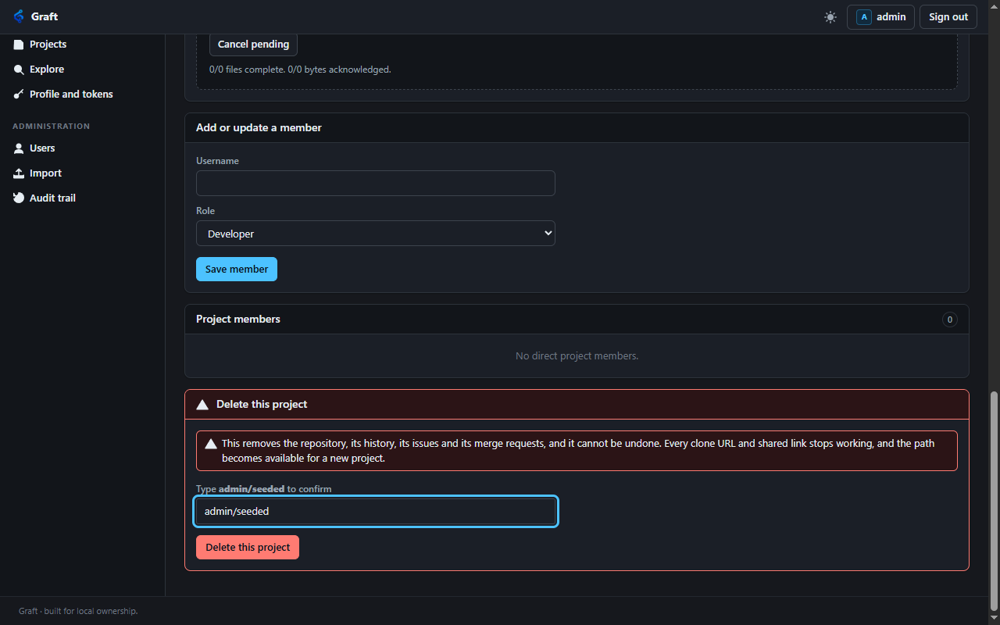

# Project deletion, the audit trail, and collaboration

Recorded: 2026-10-22. Owner: Implementation agent. Decisions:
[ADR 0013](../decisions/0013-project-deletion-and-audit.md), [ADR 0014](../decisions/0014-collaboration.md).

## What changed

Three things, from one review of what Graft could not do.

**A project can be deleted**, by its owner or an administrator. The browser asks for the path to be typed
back; the API does not, because its caller is a program. The repository goes from disk with the row.

**The audit trail can be read**, by an administrator, newest first, filtered by action or subject. It had
been written on every sensitive act since the first migration and readable by nobody without the database
file.

**A project has issues, merge requests and comments.** Reading them follows the repository, so a public
project's conversation is readable by a stranger; writing on them needs membership. Merging fast-forwards
where it can, writes a merge commit where the two sides touched different files, and refuses by name where
they touched the same one.

## Suites

| Suite | Before | After |
| --- | --- | --- |
| `Graft.Git.Acceptance` | 483 | 556 |
| `Graft.Acceptance` | 162 | 168 |
| `Graft.Mcp.Acceptance` | 101 | 101 |
| `Graft.Operations.Acceptance` | 41 | 41 |

The core suite gained six without a line being written for it: it enumerates `ProjectAction` and asserts
that a non-member and a revoked member are denied every one of them, so the two new actions were covered
the moment they existed.

The agent suite's count is unchanged because its tool-count assertion moved from 19 to 28 rather than
multiplying; the nine new tools are asserted by that one check on three transports.

## Deletion, against a running server

| Step | Result |
| --- | --- |
| A Maintainer who does not own the project deletes it | `403` |
| An anonymous caller deletes it | `404` |
| The browser sends a confirmation naming another project | `400` |
| The browser sends the right confirmation with no CSRF header | `403` |
| After all three refusals, the repository directory | still there |
| The browser sends the right confirmation and header | `204`, directory gone |
| The project afterwards | `404` from the API, nothing from the Git transport |
| Its path and instance-wide slug | free, and a new project takes both |
| Its issues, comments and membership rows | zero, read straight from the database |
| An administrator deletes somebody else's over the API | `204`, no confirmation asked for |

The row counts are read with SQL rather than through an API, because nothing can ask an API about a project
that no longer exists. A row left behind would be keyed to an id some later project could be given.

## The audit trail

| Step | Result |
| --- | --- |
| No session | `401` |
| An ordinary account | `403` |
| An administrator | a page, newest first, with `X-Total` and `X-Page` |
| Filter by `action=delete-project` | only deletions, including the two above |
| One of those entries | names the repository storage directory |
| Filter by `target_type=issue` | only issues |
| Filter matching nothing | an empty page, `200` |
| A query parameter the route does not implement | `400` |
| A full page searched for `graft_pat_`, and for both account passwords | no match |

That last row is the one worth keeping. A deletion's entry names the storage directory precisely because
nothing else will afterwards, and an entry that carried a credential would be the one place a secret
outlived its creation.

## Issues and comments

| Step | Result |
| --- | --- |
| Open an issue | `201`, numbered `1`, state `opened`, author recorded |
| Open a second | numbered `2` |
| List with a `read_api` token | both, newest first |
| Open one with a `read_api` token | `403` |
| Read issues with a repository-only token | `404` |
| Read a private project's issues with no credential | `404` |
| A Developer comments on the owner's issue | `201` |
| The issue afterwards | `user_notes_count` of 1 |
| A Developer edits the owner's issue text | `403` |
| A Developer closes the owner's issue | `403` |
| The author closes their own | `closed`, with `closed_at` set |
| The author reopens it | `opened`, `closed_at` cleared |
| A Maintainer closes and reopens somebody else's | both succeed |
| `state_event` of `resolve` | `400` |
| An issue number that names nothing | `404` |
| An issue with no title | `400` |

## Merge requests

The project is built by real `git push`, on branches arranged so each of the three merge outcomes occurs.

| Step | Result |
| --- | --- |
| Propose into a branch that does not exist | `400` |
| Propose a branch into itself | `400` |
| Propose `forward` into `trunk` | `201`, numbered `1`, independently of issues |
| A second open proposal for the same pair | `409` |
| A listing | `merge_status` of `unchecked`, deliberately undecided |
| Propose `theirs` into `mine`, which both changed `shared.txt` | `conflict`, `cannot_be_merged`, conflicts names `shared.txt` |
| Merge that one | `409`, and the message names `shared.txt` |
| Propose `feature` into a `main` that has also moved | `three_way`, `can_be_merged` |
| Its changes | one file, `feature.txt`, `added`, measured from a 40-character base |
| Merge with a `read_api` token | `403` |
| Merge `forward` into the still `trunk` | `fast_forward`, state `merged` |
| Merge `feature` into `main` | `three_way`, a 40-character merge commit |
| Merge it again | `409` |
| Reopen it | `409` |

The changes row matters: `main` gained a commit after `feature` left it, and that commit's file does not
appear in the proposal's changes. The comparison is from the merge base, which is what review wants.

Then real Git is asked whether the result is a repository:

```text
git fetch origin
git rev-list --parents -n 1 origin/main   -> three ids, so two parents
git checkout -B verify origin/main        -> feature.txt present, base.txt carries main's change
git fsck --strict --no-progress           -> exit 0
```

## Verified in a browser

Driven against the disposable fixture, which now seeds two issues, a comment and an open proposal.

- The issues list shows the open issue with its comment count, and the Open, Closed and All filters.
- The issue page shows the description and the thread. A comment posted through the form appears in the
  reloaded thread, and the count moves from 1 to 2.
- The merge request page explains the proposal in a sentence: *"main has gained nothing since this branch
  left it, so merging moves it forward with no merge commit."* It lists `lantern.txt` as added, `+1 −0`.
- Pressing Fast-forward merges it. The page then reads `merged`, *"Merged into main as c146224e"*, and the
  changes list is correctly empty because the branches have converged. The Close button is gone.
- The audit page lists 18 entries newest first, including the merge and both issues, each with its actor
  and time, and filters correctly by action.
- The project settings page shows a delete panel whose button stays disabled for a wrong path and enables
  for the right one. Deleting through it answers 204 and the project leaves the listing, with the audit
  entry naming its storage directory.



## Boundaries worth stating

**Graft does not merge file contents, and will not pretend to.** The reasoning is in ADR 0014. The
practical effect is that a team whose branches routinely touch the same files will merge locally, and the
forge's job is to say so early and precisely rather than at the moment of merging.

**The merge base is one commit, not a recursive merge of several.** Where a history criss-crosses, Git
would build a virtual base by merging the candidates and Graft picks the nearest one along the second
commit's history instead. The result is still an ancestor of both, and the difference can only change which
paths are reported as conflicting, never whether a merge is written incorrectly.

**Mergeability is computed on read and never stored.** A proposal's answer is current as of the request and
can change with the next push, which is why a listing declines to answer at all.

**The audit trail is instance-wide and administrator-only.** A project Maintainer cannot see their own
project's events. That is a real gap for a delegated project and is in [the backlog](../backlog.md).

## Not done

**No line-level comments on a diff.** Comments attach to an issue or a proposal as a whole. This is the
single largest remaining difference between Graft's review and the review people expect.

**No labels, milestones, assignees, approvals or draft state.** None are modelled.

**No editing a comment.** It can be deleted by its author or a Maintainer, and that is all.

**No browser check of the conflict path.** The fast-forward merge was driven by hand; the conflicting and
three-way cases were exercised over HTTP only. The sentence the interface shows for a conflict has not been
read on a screen.

**An empty repository's project page still reads "Repository unavailable".** Found while checking this work
and unrelated to it: the browse endpoint answers 404 when there is no tree, and the page reports that as a
permission problem. Recorded in the backlog rather than fixed here.
