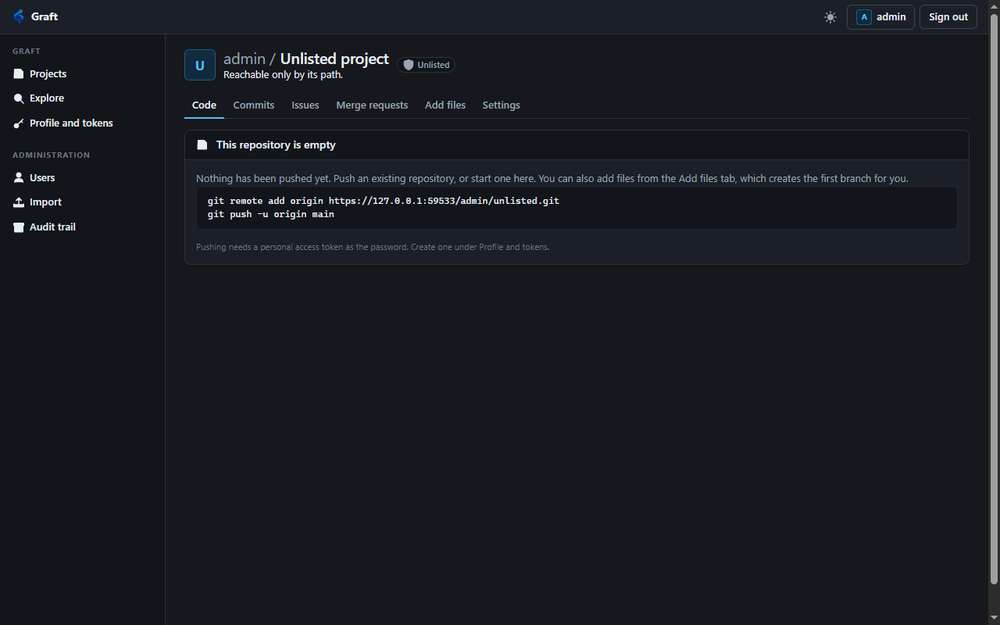

# Getting things out, and two defects

Recorded: 2026-10-22. Owner: Implementation agent. Decision:
[ADR 0017](../decisions/0017-getting-things-out.md).

## What changed

**Two defects, both about a page reporting the wrong thing.** A project somebody had just created said
"You do not have access to this project", because the browse endpoint answered 404 when there was no tree
and the page reports that as a permission problem. And a commit link into a public project failed for
anybody who was not a member, because the commit page resolved the project through the caller's own project
listing rather than through the endpoint that answers for any reader.

**Then the way out.** A file can be downloaded as bytes, the whole tree can be downloaded as a gzipped tar
or a zip, and tags are listed, created and deleted. Until now the only way to get anything out of Graft was
to clone it.

## Suites

| Suite | Before | After |
| --- | --- | --- |
| `Graft.Git.Acceptance` | 603 | 641 |
| `Graft.Acceptance` | 168 | 168 |
| `Graft.Mcp.Acceptance` | 101 | 101 |
| `Graft.Operations.Acceptance` | 41 | 41 |

## The empty repository

| Step | Result |
| --- | --- |
| Browse a project nobody has pushed to | `200`, a page rather than a 404 |
| Its branches, commits and tree | all empty, readme null |
| What it still carries | `can_push`, and a clone URL ending `.git` |
| The same project, read by a stranger | `404`, because being empty is not a reason to be visible |
| An archive of it | `404`, because there is no revision to archive |

In a browser the page now reads *"This repository is empty. Nothing has been pushed yet."* with the two
commands that end it, the project header, and all its tabs.

## The commit page's premise

The fix itself is a client change, so what is asserted is the difference between the two endpoints it
chose between.

| Step | Result |
| --- | --- |
| A public project, listed through a non-member's own project listing | absent |
| The same project, resolved by path through the browser repository endpoint | found |
| Its files, downloaded with no credential at all | served |

The first row is why the old code failed and the second is why the new code works.

## Tags

| Step | Result |
| --- | --- |
| A repository with none | an empty listing |
| Create with a read-only token | `404` |
| Create `v1.0.0` at `main` | `201`, naming the commit it resolves to |
| Create it again | `409` |
| Create at a revision that does not resolve | `400` |
| An annotated tag pushed by a real Git client | listed beside the API-created one |
| That tag's `target` and `commit` | different, and the commit is the right one |
| Delete a tag | `204` |
| Delete it again | `404` |

The annotated-tag row is the one worth keeping. A reference pointing at a tag object rather than at a
commit is the case a listing gets wrong if it reports only one of the two.

## One file, as bytes

| Step | Result |
| --- | --- |
| A text file | its exact bytes |
| Its content type | `application/octet-stream`, never the type the content looks like |
| Its disposition | `attachment` |
| Its sniffing header | `nosniff` |
| A binary file | byte for byte, which nothing else in the API could return |
| A file that is not there | `404` |
| A private project, no credential | `404` |
| A public project, no credential | served |
| The browser's own route | serves the same bytes, and conceals the same projects |

The three header rows are the feature. Repository bytes reaching this origin as a document would be
somebody else's script running where the session cookie lives, which is the same reason project sites have
a hostname of their own.

## The whole tree

| Step | Result |
| --- | --- |
| `archive.zip` | an attachment of unknown type |
| Opened as a zip | three entries, all under `fetchable-<short sha>/` |
| One entry's contents | the file's exact bytes |
| `archive.tar.gz`, decompressed and read as a tar | the same three files |
| The executable file in it | unpacks executable |
| A revision that does not resolve | `404` |
| A private project, read by a stranger | `404` |
| The route with no extension | a tarball |
| The route at a tag | served |

The archive is opened and read with the framework's own zip and tar readers rather than being checked by
size, so "it produced an archive" means a reader could actually open it.

## Verified in a browser

- An empty repository renders as an empty state with push instructions, not as a refusal.
- The repository header carries a Download button linking to `archive.zip` at the branch being viewed.
- The file view carries a Download button pointing at Graft's own raw route, which a session can use.
  The first version pointed at the GitLab-shaped route, which answers a token and would have refused every
  reader of a private project. Found by pressing it.
- The settings page shows a Tags panel. Creating `v1.0.0` through it succeeds, the tag appears with its
  commit title, and it carries its own download link and a two-step delete.

## Boundaries worth stating

**A browser cannot preview a raw file.** That is the cost of never guessing a content type, and it is the
right trade: the repository browser renders text, and the raw route exists to produce bytes.

**An archive is built in memory.** Sound only because the Git engine bounds a repository at a few tens of
megabytes. If that bound is ever raised, this has to become streaming before the bound moves.

**Tags created through Graft are lightweight.** An annotated tag carries a message and a tagger, which
belong to a release. Tags pushed by a client keep whatever form they were given.

## Not done

**No releases.** No notes, no attachments, no marking a tag as a release. That remains its own feature in
[the backlog](../backlog.md).

**No `MERGE /repository/merged_branches`**, and no protected branches or tags of any kind.

**No archive of a subdirectory**, which GitLab supports with a `path` parameter.

**No browser check of a tar download**, only of the zip. Both were exercised over HTTP.
