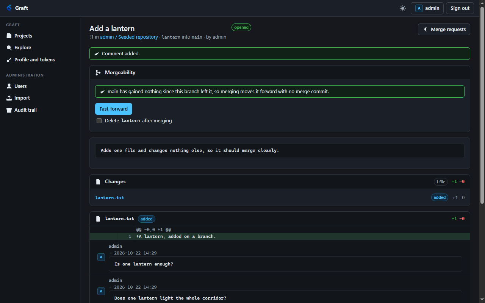

# The rest of the review journey, and webhooks

Recorded: 2026-10-22. Owner: Implementation agent. Decisions:
[ADR 0015](../decisions/0015-review-journey.md), [ADR 0016](../decisions/0016-webhooks.md).

## What changed

Five gaps, found by walking the merge request journey end to end on the day merge requests were built.

**The proposal page shows the change.** It had listed which files differed and by how many lines, and shown
none of the diff, so review happened by cloning. The hunks had been in the response since the beginning.

**A comment can name a line.** It records the commit the diff was computed from, and when the branch moves
it is reported as outdated rather than silently re-anchored to whatever now occupies that line number.

**A project can require approvals.** An approval counts only against the branch tip it was given for, so a
push supersedes it. An author cannot approve their own, approving needs the permission to push, and the
gate is enforced inside the merge rather than only in the interface.

**Branches can be made and removed without a Git client**, and a merge can take the source branch with it.

**A project can ask to be told.** `--webhooks true`, off by default, lets a project register a signed hook
for pushes, issues, merge requests and comments.

## Suites

| Suite | Before | After |
| --- | --- | --- |
| `Graft.Git.Acceptance` | 556 | 603 |
| `Graft.Acceptance` | 168 | 168 |
| `Graft.Mcp.Acceptance` | 101 | 101 |
| `Graft.Operations.Acceptance` | 41 | 41 |

The agent suite's count is unchanged because its tool-count assertion moved from 28 to 29; the one new tool
and the extended `graft_comment` are covered by that check on three transports.

## Branches

| Step | Result |
| --- | --- |
| Create with a read-only token | `404` |
| Create `wick` from `main` | `201`, with the commit it points at |
| Create `wick` again | `409`, refused rather than moved |
| Create from a revision that does not resolve | `400` |
| Delete a branch | `204` |
| Delete it again | `404` |
| Delete the branch the project opens at | `409` |
| The remaining branches | unchanged, and the deleted branch's commits are still in the repository |

## A comment on a line

| Step | Result |
| --- | --- |
| Send a path with no line or side | `400` |
| Send a side of `middle` | `400` |
| Send path, line and side together | `201`, carrying all three and a 40-character anchor, `outdated` false |
| The same from a Reporter | `201`, because commenting needs membership rather than the ability to push |
| The same on an issue | `400`, because an issue has no diff |
| After a push to the source branch | every anchored comment reports `outdated` |
| And its anchor | still names the commit it was written against |

## Approvals

| Step | Result |
| --- | --- |
| A new project | `approvals_required` 0, `approvals_left` 0 |
| A Maintainer sets the rule to 1 | `204` |
| A Developer sets the rule | `403` |
| Merge with the rule unmet | `409`, and the message says how many are outstanding |
| The author approves their own | `409` |
| A Reporter approves | `403` |
| A Developer approves | `approvals_left` 0, the approval reports `current` |
| A push to the source branch | `approvals_left` back to 1, the approval reports `current` false |
| Merge again | `409` |
| Withdraw the approval | the list is empty |
| Approve, then merge with `should_remove_source_branch` | merged, `source_branch_removed` true |
| The branches afterwards | only `main` |
| The merged work | on `main`, read from a fresh checkout after the source branch was removed |

The push in the middle is the row that matters. The approval was given, the branch moved, and the gate
closed again without anybody withdrawing anything.

## Webhooks

The suite runs its own receiver on loopback, so the delivery is observed arriving rather than assumed.

| Step | Result |
| --- | --- |
| Hook routes on a server without `--webhooks` | `404`, absent rather than refusing |
| A server with it | prints `WEBHOOKS: on` at startup |
| A signing secret of eight characters | `400` |
| An address of `file:///etc/passwd` | `400` |
| An event named `everything` | `400` |
| A valid hook | `201`, and the response contains the secret nowhere |
| Opening an issue | delivered, `X-Graft-Event` of `issue` |
| The signature | equals an HMAC the suite computes independently over the exact body |
| The payload | names the action, the issue title and the project path |
| The payload searched for the secret and the API token | neither appears |
| The hook afterwards | `last_status` 200 |

The signature is computed in the test from the secret and the received bytes, rather than by calling the
server's own signing code, so the assertion checks the format a receiver would implement rather than
agreeing with itself.

## Verified in a browser

Against the disposable fixture, signed in as the seeded administrator.

- The merge request page renders the diff: the hunk header, the added line highlighted, the file summary
  above it, and a comment affordance in the gutter of each line.
- Pressing that affordance opens a form under the line. Submitting it places the comment directly beneath
  the line, and the conversation panel then reads *"Everything said so far is on a line of the diff above."*
- With approvals required set to one, the page reads *"0 of 1 approvals of the current branch"*, the merge
  button is gone, and because the signed-in account is the author it says *"You cannot approve your own
  proposal."* rather than offering a button that would be refused.
- The project settings page shows Branches and Review panels. The Webhooks panel is correctly absent,
  because the fixture runs without the operator's switch.

## Something this found

The approvals field on the settings form was initialised to zero rather than from the project, so saving the
form would have silently removed a gate somebody had set. Found by reading the rendered page and comparing
it against what the API reported. `RepositoryPageResponse` now carries `approvals_required`, loaded only for
a caller who can change it.

## Boundaries worth stating

**A delivery is a notification, not a guarantee.** The queue is bounded and in memory, a restart loses what
it held, and a full queue drops its oldest entry. A receiver that must not miss an event should reconcile
against the API rather than trust that it heard.

**A line comment ages rather than moves.** This is deliberate and is the opposite of what other forges do;
the reasoning is in ADR 0015. The practical effect is that a reviewer returning after a push re-reads rather
than assuming their comments still point where they left them.

**Turning webhooks on lets a project Maintainer make the server call an address they choose.** The operator
switch is the control; the server does not second-guess the address beyond requiring http or https with no
embedded credentials.

## Not done

**No reply or thread on a line comment.** Each is standalone. Resolving a conversation does not exist.

**No editing a comment**, on a line or otherwise. It can be deleted by its author or a Maintainer.

**No browser check of an outdated comment or a superseded approval.** Both were exercised over HTTP. The
sentences the interface shows for them have not been read on a screen.

**No instance-wide webhooks, no redelivery, no test button**, and no way to disable a hook short of
removing it.

**Approvals do not name who is required.** The rule is a count, not a set of people or a set of paths.
