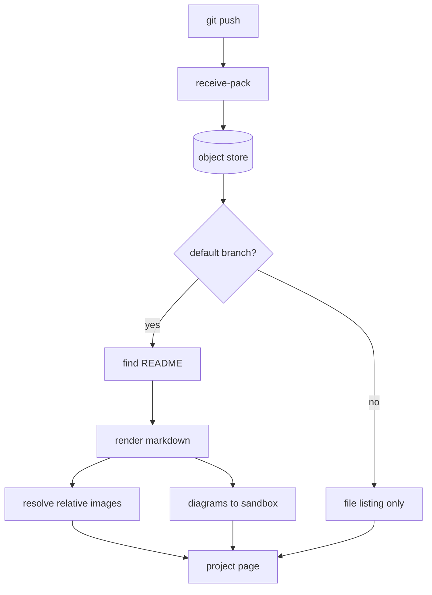
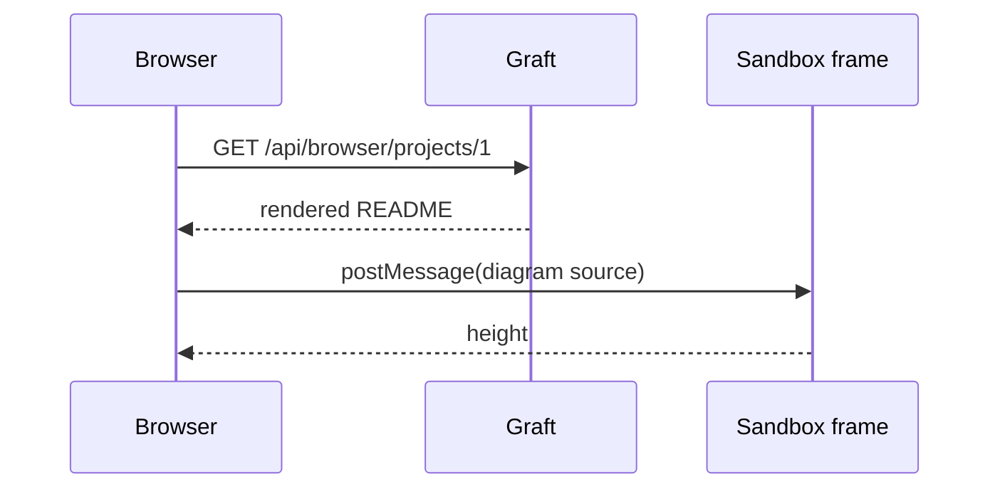

# Graft

A locally hosted forge that speaks Git and GitLab's API, built as a single self-contained binary with no
runtime to install and no container to orchestrate.


> **This README is the rendering fixture.** It is seeded into the disposable browser fixture so that every
> piece of markdown syntax Graft supports is visible on one page. If something here looks wrong, the renderer
> is wrong.

## Why

Self-hosting a forge usually means accepting an operational footprint far larger than the thing being
hosted. Graft is the opposite trade: one process, one SQLite database, one directory of repositories.

- Clone, fetch and push with an unmodified `git` client
- Read projects, commits and files through GitLab's REST shape, so existing tooling works
- Browse repositories, branches and files in the browser
- Host it on a machine you already have

## Status

| Area | State | Notes |
| :--- | :---: | ----: |
| Git over HTTPS | working | smart protocol v0, server-authored objects |
| GitLab REST reads | working | projects, commits, files, users |
| Browser UI | working | branches, files, README rendering |
| Merge requests | planned | not started |
| Continuous integration | planned | not started |

## Getting started

Build the server and point it at a database and a repository root:

```powershell
dotnet publish src\Graft.Server\Graft.Server.csproj -c Release -r win-x64 --self-contained true
.\Graft.Server.exe --database graft.db --repositories .\repositories
```

Then clone from it the way you would from anywhere else:

```bash
git clone https://graft.example.invalid/alice/project.git
```

The configuration file is ordinary JSON:

```json
{
  "listen": "https://0.0.0.0:8443",
  "repositories": "/var/lib/graft/repositories"
}
```

And a fence with no language at all stays plain:

```
--database <path>   the SQLite database
--repositories <d>  where bare repositories live
--licences          the third-party notices this build redistributes
```

## How a push becomes a rendered page



Diagrams render inside a sandboxed frame with no access to this origin, so a diagram in somebody else's
repository cannot reach your session.



## Design notes

### What the renderer does

Raw HTML in a README is **escaped, never parsed**. Every element on the page is generated by the renderer
rather than copied from the document, so a repository cannot introduce markup of its own. Link and image
destinations are checked while they are still structured values, and the output is scanned once more before
it is sent.

Three properties follow from that:

1. An image resolves against the repository or it does not load at all
2. A link that leaves the site carries `rel="noopener noreferrer nofollow"`
3. A document the renderer cannot vouch for is shown as plain text

### Terminology

Graft
:   a forge you run yourself, named for the horticultural join rather than the other sense

Forge
:   a place repositories live, with the review and issue machinery around them

Compatibility layer
:   the GitLab-shaped REST surface, so existing clients need no changes

### Progress

- [x] Git over HTTPS
- [x] Personal access tokens
- [x] Repository browsing
- [x] README rendering
- [ ] Merge requests
- [ ] Continuous integration

## Formatting the renderer supports

Ordinary emphasis: *italic*, **bold**, ***both***, ~~struck through~~ and `inline code`.

Extras: ++inserted++, ==highlighted==, 2^nd^ and H~2~O.

Nested structure:

- Transport
  - Git smart HTTP
  - GitLab REST
- Storage
  1. objects on disk
  2. metadata in SQLite

> Block quotes carry prose that is not mine.
>
> > And they nest, when a quotation quotes something in turn.

Links come in several forms: a [relative document](docs/assets/README.md), an
[external page](https://git-scm.com/docs/http-protocol), an [address](mailto:nobody@example.invalid),
an [anchor](#design-notes), and a bare autolink such as <https://www.sqlite.org/backup.html>.

An image from outside the repository is not fetched, because no README should be able to tell your browser
to contact a third party: .
It appears above as a link you can follow deliberately instead.

Footnotes work too[^why-sqlite], and so do horizontal rules:

---

That is the whole syntax surface. Anything not shown here either renders as plain text or is deliberately
refused.

[^why-sqlite]: One file, no server process, and an online backup API that works while the forge is running.
